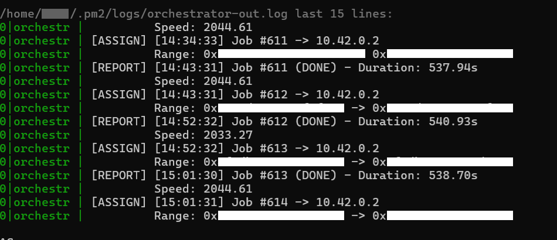

# Bitcoin Puzzle Orchestrator

A compartmentalized setup for brute forcing bitcoin puzzle wallets. Server acting as C2 and a "dumb" rig to do work and report back. The bitcoin puzzles are explained [here](#what-are-the-bitcoin-puzzles).

## Features
- Get Telegram messages of daily mining reports and urgent alerts when the key is found
- Never guess the same key twice, systematically logs guesses without replacement
- Built for vanitysearch but works with other cracking software
- High quality randomized guesses using crypto
- Can support many miners at once


## Architecture
Orchestrator (Server): 
- Headless (optional), Linux
- Runs on Raspberry Pi or server of your choice
- Manages `mining.db` SQLITE
- Exposes a REST API
- Can handle Wake on LAN for the Rig

Rig (Client):
- Headless (optional), Linux
- Requests work from the server 
- Runs `vanitysearch` on the assigned range
- Reports results (MKeys/sec, success, failure, key) to server


## Installation

This runs on top of cracking software, I recommend using [this version of VanitySearch](https://github.com/allinbit/VanitySearch), download this and then you can install the following in the same directory:
### Orchestrator
Clone the repo to your server (e.g., Raspberry Pi).
```bash
cd orchestrator
npm install
cp ../.env.example .env
# Edit .env with your preferences, then:
node server.js
```

### Rig (GPU Client)
Clone the repo to the mining rig:
```bash
cd rig
# Ensure you have 'jq', 'curl' and 'python3' installed
sudo apt install jq curl python3
cp ../.env.example .env
# Configure SERVER_IP and MINER_BINARY in .env
bash miner.sh
```

Update the orchestrator before the rig, so the rig can return unfinished work.

You can stop the miner at any time. A range only counts as searched when the miner reports that it covered all of it; anything interrupted is returned to the orchestrator and searched again later. A found key is saved on the rig as `FOUND_KEY_*.pending.txt` until the orchestrator confirms it.


## Configuration (.env)
Rename `.env.example` to `.env` and fill in your details:
```
SERVER_IP=192.168.1.100
TARGET_ADDRESS=1PWo3JeB9jrGwfHDNpdGK54CRas7fsVzXU
TELEGRAM_BOT_TOKEN=your_token_here
```


## Alerts
Run the alert script to check the status or send a daily report:
```bash
# Check status (Run via Cron every hour)
node alert.js check

# Send Daily Report (Run via Cron every 24h)
node alert.js report
```

to set up with `cron` to do hourly checks and daily reports, first find node's path:
```
which node
```

then edit crontab:
```bash
crontab -e
```

Add these lines to the bottom of the file, note that I have added a `cd` command to the start of each line. This forces Cron to "move" into your folder before running the script, ensuring it finds your `.env` file:
```bash
# HEALTH CHECK (Runs every hour on the hour)
# Checks if the miner crashed or if a key was found.
0 * * * * cd /home/user/orchestrator && /usr/bin/node alert.js check >> cron_check.log 2>&1

# DAILY REPORT (Runs every day at 9:00 AM)
# Sends you the total keys searched and system status.
0 9 * * * cd /home/user/orchestrator && /usr/bin/node alert.js report >> cron_report.log 2>&1
```

Save and Exit
Nano: Press `Ctrl+O`, `Enter`, then `Ctrl+X`.

To test run the command manually
```bash
cd /home/user/orchestrator && /usr/bin/node alert.js check
```

## Setup
For more information on how to:
- get everything automated
- to run the programs in the background
- safely exit the rig and server
- access the server from any network
- configure other details

[read the full setup guide here](./SETUP.md).

Once running, logs on the server should look like this, speed is in Million Keys per sec:


## What are the Bitcoin Puzzles
In 2015, before Bitcoin was valuable, somebody created a series of puzzles of increasing difficulty. They made Bitcoin wallets with private keys that were each one bit longer than the previous. The first being 1 bit, second being 2, and so on. There is now 160 total puzzles but they have only been solved up to 71.

The reward for puzzle 71 is 7.1BTC. The normal Bitcoin private key is 256 bit, to crack it, you essentially need to guess 256 coin flips in a row correctly. But for 71, it is less. It's solvable with enough luck, though you'll still need quite a bit.

The number of possibilities is:
```
one sextillion one hundred eighty quintillion five hundred ninety-one quadrillion six hundred trillion
```

But guessing over a billion keys per second, you can get a more reasonable chance of guessing correctly. Here's an example of your odds for 71 at 1.833BKeys/sec:
```
With ranges of 1.1 trillion, there is 1073265110 possible ranges. 

Giving about a 1 in 1 billion chance every ten minutes (1.833B Keys/s)

0.000000093173624% ≈ 10 minutes
0.0000134170019% ≈ 24 hours
0.0000939190132% ≈ 1 week
0.037567605% ≈ 1 month
```

To learn more about the puzzle [visit this site](https://btcpuzzle.info/).

## Cashing Out (Avoid Front-runners)

There's a real issue with cashing out. Bots are set up so that when these challenge wallets get cracked and the winner submits a transaction, they pair the public key, with the public address to bring the solution from 2^71 to around 2^35, solvable in minutes on good GPU.

Then, once it is solved, they also have the private key. They make a transaction, sending the full amount of funds to themself with a way bigger fee so they get picked up by the miners first and get the money. 

The way to avoid this is to use MARA's slipstream service. They provide a service where they will not put your transaction on the public ledger but will silently put you on the next block. This is practically a guarantee not to get your winnings booked.
