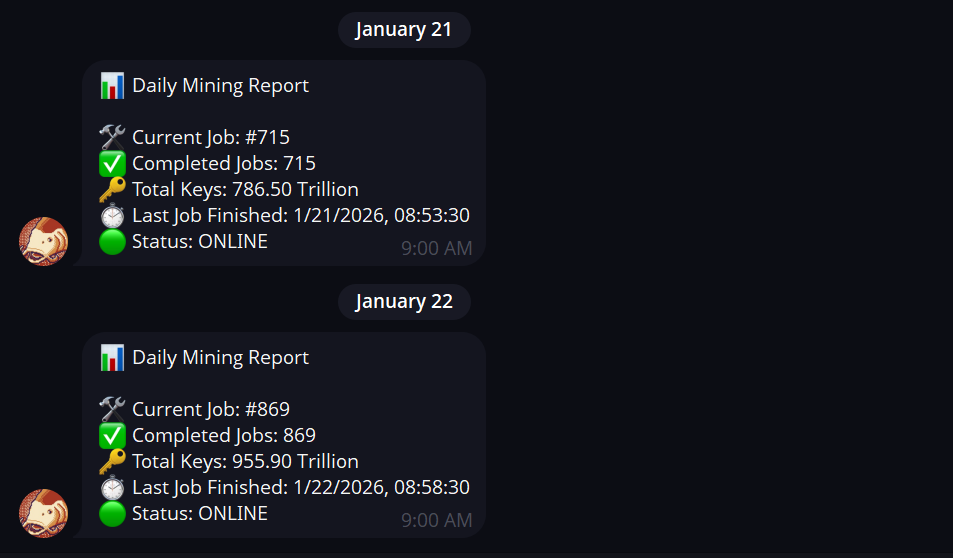

# Bitcoin Puzzle Orchestrator

A compartmentalized setup for brute forcing bitcoin puzzle wallets. Server acting as C2 and a "dumb" rig to do work and report back.

## Features
- Get Telegram messages of daily mining reports and urgent alerts when the key is found
- Never guess the same key twice, systematically logs guesses without replacement
- Built for keyhunt but works with other cracking software
- High quality randomized guesses using crypto
- Can support many miners at once



## Architecture
Orchestrator (Server): 
- Headless (optional), Linux
- Runs on Raspberry Pi or server of your choice
- Manages `mining.db` SQLITE
- Exposes a REST API
- Can handle Wake on LAN for the Rig

Rig (Client):
- Headless (optional), Linux
- Requests work from the server 
- Runs `vanitysearch` on the assigned range
- Reports results (MKeys/sec, success, failure, key) to server


## Installation
### Orchestrator
Clone the repo to your server (e.g., Raspberry Pi).
```bash
cd orchestrator
npm install
cp .env.example .env 
# Edit .env with your preferences node index.js
```

### Rig (GPU Client)
Clone the repo to the mining rig:
```bash
cd miner
# Ensure you have 'jq' and 'curl' installed
sudo apt install jq curl
cp .env.example .env
# Configure SERVER_IP in .env
./miner.sh
```


## Configuration (.env)
Rename `.env.example` to `.env` and fill in your details:
```
SERVER_IP=192.168.1.100
TARGET_ADDRESS=13zb1hQbWVsc2S7ZTZnP2G49vgCNJrQ5
TELEGRAM_BOT_TOKEN=your_token_here
```


## Alerts
Run the alert script to check the status or send a daily report:
```bash
# Check status (Run via Cron every hour)
node alert.js check

# Send Daily Report (Run via Cron every 24h)
node alert.js report
```

to set up with `cron` to do hourly checks and daily reports, first find node's path:
```
which node
```

then edit crontab:
```bash
crontab -e
```

Add these lines to the bottom of the file, note that I have added a `cd` command to the start of each line. This forces Cron to "move" into your folder before running the script, ensuring it finds your `.env` file:
```bash
# HEALTH CHECK (Runs every hour on the hour)
# Checks if the miner crashed or if a key was found.
0 * * * * cd /home/user/orchestrator && /usr/bin/node alert.js check >> cron_check.log 2>&1

# DAILY REPORT (Runs every day at 9:00 AM)
# Sends you the total keys searched and system status.
0 9 * * * cd /home/user/orchestrator && /usr/bin/node alert.js report >> cron_report.log 2>&1
```

Save and Exit
Nano: Press `Ctrl+O`, `Enter`, then `Ctrl+X`.

To test run the command manually
```bash
cd /home/user/orchestrator && /usr/bin/node alert.js check
```

## Setup
For more information on how to:
- get everything automated
- to run the programs in the background
- safely exit the rig and server
- access the server from any network
- configure other details

[read the full setup guide here](./SETUP.md).

Once running, logs on the server should look like this, speed is in Million Keys per sec:

